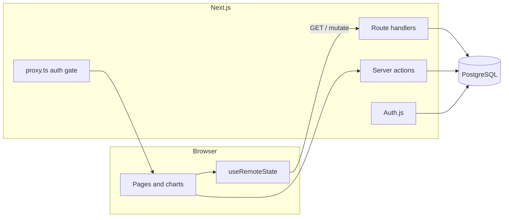

# Finlytics

**[Live Demo](https://finlytics-fawn.vercel.app)**

Personal finance dashboard: track income and expenses, set monthly per-category budgets, and visualize cash flow. Sign in with email/password or Google. Every account’s data is isolated in PostgreSQL.

<!-- Add a screenshot after pushing it to the repo, e.g. docs/dashboard.png:

-->

**Stack:** Next.js 16 (App Router) · React 19 · TypeScript · Tailwind CSS v4 · Prisma 7 · PostgreSQL · Auth.js v5 · Recharts

## Features

- **Dashboard** — summary stats, cashflow chart, expense breakdown, recent transactions
- **Transactions** — add, edit, delete; filter by month, type, and search; paginated table
- **Budgets** — per-category monthly limits; unset months inherit from the latest earlier month
- **Categories** — custom labels and icons, stored per user
- **Profile** — display name, password, light/dark theme
- **Auth** — JWT sessions (30 days), bcrypt passwords, optional Google OAuth

Money is stored as signed integer cents on the server; the UI uses normal decimal amounts. Dates are `yyyy-MM-dd` strings (local calendar in forms, not UTC midnight).

## Quick start

Requires Node.js 20+ and a PostgreSQL database (Neon, Supabase, Vercel Postgres, or local).

```bash
git clone https://github.com/BhumikRajput/finlytics.git
cd finlytics
npm install
cp .env.example .env    # PowerShell: Copy-Item .env.example .env
```

Set **`DATABASE_URL`** and **`AUTH_SECRET`** in `.env` (`npx auth secret` generates a secret).

```bash
npx prisma migrate dev
npx prisma generate
npx prisma db seed      # optional: demo user + sample data
npm run dev
```

Open [http://localhost:3000](http://localhost:3000). After seeding: `alex@example.com` / `demo12345` (override with `SEED_USER_*` in `.env`).

| Command | Purpose |
| --- | --- |
| `npm run dev` | Development server |
| `npm run build` / `npm start` | Production build and serve |
| `npm run vercel-build` | `prisma migrate deploy` then `next build` (Vercel) |
| `npm run lint` | ESLint |
| `npm run seed` | Regenerate demo data for “today” and reload the demo user (`--reset`) |

## Architecture



- **`src/proxy.ts`** — keeps signed-out users on `/login` and `/register`; API routes return JSON `401` instead of redirects.
- **`getSessionUserId()`** — JWT/cookie only (reads). **`getCurrentUserId()`** — also verifies the user row exists (writes and sensitive paths).
- **`useRemoteState`** — optimistic updates, global serialized request queue, rollback + toast on failure, re-sync when idle.

Provider order (inside the authenticated app shell only): Toast → Transactions → Period → Categories → Budget → Sidebar.

## Environment variables

| Variable | Required | Notes |
| --- | --- | --- |
| `DATABASE_URL` | Yes | PostgreSQL connection string (pooled is fine for the running app) |
| `DATABASE_URL_UNPOOLED` | No | Direct connection used by Prisma migrations; falls back to `DATABASE_URL` |
| `AUTH_SECRET` | Yes | `npx auth secret` |
| `AUTH_GOOGLE_ID` / `AUTH_GOOGLE_SECRET` | No | Enables “Continue with Google” |
| `AUTH_URL` / `AUTH_TRUST_HOST` | Prod (non-Vercel) | See `.env.example` |

**Google OAuth:** create a Web client at [Google Cloud Console](https://console.cloud.google.com/apis/credentials). Add these redirect URIs:

- Local: `http://localhost:3000/api/auth/callback/google`
- Production: `https://<your-domain>/api/auth/callback/google`

Publish the consent screen or only test users can sign in. Use your main domain (not a per-deployment Vercel URL) when signing in, since Google only accepts registered redirect URIs.

## API (REST)

All routes scope data by the signed-in user. Writes validate bodies (`src/lib/api-helpers.ts`, `transactions-api.ts`, `categories-api.ts`).

| Method + path | Description |
| --- | --- |
| `GET/POST /api/transactions` | List / create |
| `PATCH/DELETE /api/transactions/[id]` | Update / delete (delete is idempotent) |
| `POST /api/transactions/reassign` | Move all rows from one category to another |
| `GET /api/budgets` | All months as `{ "yyyy-MM": { category: amount, … } }` |
| `PUT /api/budgets/[month]/[category]` | Set one cell (copies inherited month on first edit) |
| `POST /api/budgets/merge` | Merge one category’s budgets into another |
| `GET/POST /api/categories` | List (seeds defaults on first call) / add custom |
| `PATCH/DELETE /api/categories/[value]` | Rename / delete custom (409 if still in use) |

## Project layout

```
src/app/(auth)/       Login and register (no data providers)
src/app/(app)/        Dashboard, transactions, budget, categories, profile
src/app/api/          Transactions, budgets, categories, Auth.js
src/components/       Shell, charts, modals, auth forms
src/lib/              Contexts, validation, server actions, Prisma client
prisma/               Schema, migrations, seed, demo-data generator
```

Prisma client is generated into `src/generated/prisma` (git-ignored; `postinstall` runs `prisma generate`).

## Deploying on Vercel

The live demo runs on Vercel with a Neon Postgres database.

1. Attach a Postgres database; set `DATABASE_URL`, `DATABASE_URL_UNPOOLED` and `AUTH_SECRET` for Production (and Preview if needed).
2. Add Google OAuth vars and the production callback URL if using Google.
3. Connect the repo — `vercel-build` runs migrations then `next build`.
4. Avoid `npm run seed` in production unless you want the demo account.

## Roadmap

Email verification, forgot-password flow, rate limiting on auth endpoints, and account deletion are not implemented yet.

## License

[MIT](LICENSE)